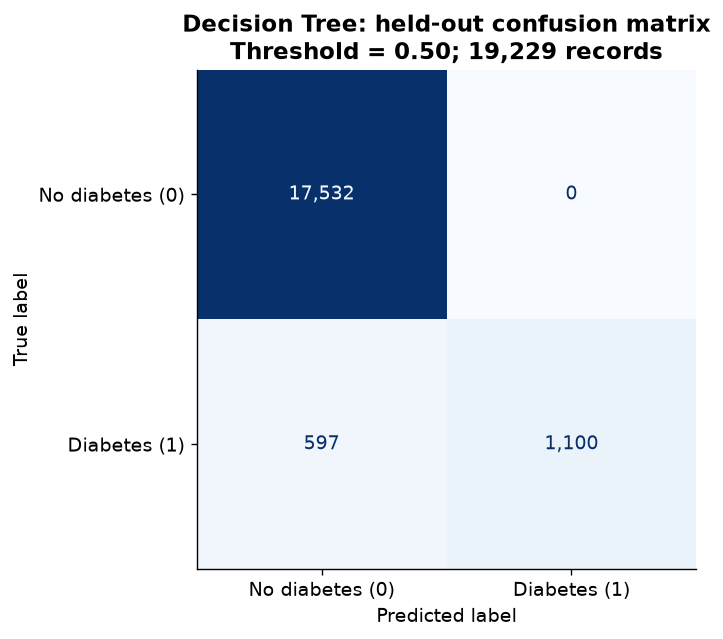

# Diabetes Classification — Three-Model Comparison

Compare Logistic Regression, Decision Tree and Random Forest using the [Mustafa Ali diabetes dataset](https://www.kaggle.com/datasets/iammustafatz/diabetes-prediction-dataset). Target: `diabetes` (1 = positive). Assignment due: **November 2, 2026**.

## Model comparison

All models use the same 19,229 held-out records, with probability threshold 0.50. Precision, recall and F1 refer to the positive class. Higher values are better for every metric below.

| Model | Accuracy | Precision | Recall | F1-score | ROC-AUC | Average precision |
|---|---:|---:|---:|---:|---:|---:|
| Logistic Regression | 0.9581 | 0.8766 | 0.6111 | 0.7201 | 0.9648 | 0.8221 |
| Decision Tree | 0.9690 | 1.0000 | 0.6482 | 0.7866 | 0.9746 | 0.8555 |
| Random Forest | 0.9691 | 0.9964 | 0.6523 | 0.7885 | 0.9747 | 0.8766 |

**Selection rule:** choose the highest mean training-only CV F1 before looking at test results. Decision Tree and Random Forest are essentially tied in CV; Random Forest has marginally higher test F1. No statistically meaningful superiority is claimed.

## Three-sentence justification

Decision Tree is selected by training-only cross-validation F1 (0.8059 versus 0.8057 for Random Forest), with essentially tied CV performance and a simpler single-tree model. On the held-out set it achieves accuracy 0.9690, precision 1.0000, recall 0.6482, F1 0.7866 and ROC-AUC 0.9746, with 1,100 true positives, 17,532 true negatives, 0 false positives and 597 false negatives; Random Forest has marginally higher test F1 (0.7885). F1 is preferable to accuracy alone for these imbalanced labels, but the tiny model gap and remaining missed positives do not establish meaningful superiority or clinical validity.

## Selected model confusion matrix



Rows are actual labels; columns are predicted labels. TN = 17,532; FP = 0; FN = 597; TP = 1,100. The zero observed false positives does not imply perfect precision in other samples.

## Method and reproducibility

- Raw data: 100,000 rows, 9 columns, 8.5% positive labels, no missing cells.
- Remove 3,854 exact duplicate rows, leaving 96,146. Retain 91 predictor signatures with conflicting labels; keep every identical predictor signature in one split.
- Approximate 80/20 stratified group split, seed 42: 76,917 train / 19,229 test. Patient independence cannot be verified without identifiers.
- Three-fold stratified group CV; same folds and fixed small parameter grids for all models, chosen by positive-class F1. Tuning CV scores are descriptive and may be optimistic.
- Numeric imputation and standardization plus categorical imputation and one-hot encoding are fitted inside the model pipeline. Keep smoking `No Info` and every gender category.
- The class-0 majority baseline has zero positive-class recall/F1; high accuracy alone is inadequate.
- Independently recalculate Accuracy/Precision/Recall/F1 from each confusion matrix; reconcile counts with the test population and verify train/test group separation.

## Run locally or on Kaggle

Tested with Python 3.14; use Python 3.11+ and:

```sh
python -m pip install -r requirements.txt
jupyter notebook Diabetes_Classification_Comparison.ipynb
```

Choose **Restart Kernel and Run All Cells**. Or execute and save from a terminal:

```sh
python -m jupyter nbconvert --execute --to notebook --inplace Diabetes_Classification_Comparison.ipynb --ExecutePreprocessor.timeout=900
```

Attach **iammustafatz/diabetes-prediction-dataset** on Kaggle; the notebook locates its CSV under `/kaggle/input`. Locally put `diabetes_prediction_dataset.csv` beside the notebook or in `data/`. Otherwise the notebook downloads the original archive (internet required). The exact CSV SHA-256 is checked, and every rerun writes results to `results/`.

## Deliverables

- `Diabetes_Classification_Comparison.ipynb`: executed notebook with 3 trained models, CV selection, metrics and 4 rendered figures.
- `model_comparison.csv`: the full comparison table.
- `best_model_confusion_matrix.png`: the selected model's confusion matrix.
- `JUSTIFICATION.md`: the three-sentence justification.
- `Diabetes_Classification_Submission.zip`: complete notebook bundle, including CV parameters, matrices for all models, data-quality and split summaries, provenance and all figures in `results/`.
- `requirements.txt`: tested package versions.

## Source and limits

The [Kaggle source](https://www.kaggle.com/datasets/iammustafatz/diabetes-prediction-dataset) lists the data license as “Data files © Original Authors.” This repository links to the source rather than redistributing the CSV. No patient-level medical records are exported in the derived tables.

The dataset does not establish patient identity, collection chronology, sampling representativeness or how labels were generated. Laboratory features may already reflect the recorded label. These retrospective scores do not establish prospective prediction or clinical validity, and a default 0.50 threshold is not a clinically optimized decision rule.

References: [scikit-learn model evaluation](https://scikit-learn.org/stable/modules/model_evaluation.html), [StratifiedGroupKFold](https://scikit-learn.org/stable/modules/generated/sklearn.model_selection.StratifiedGroupKFold.html).
